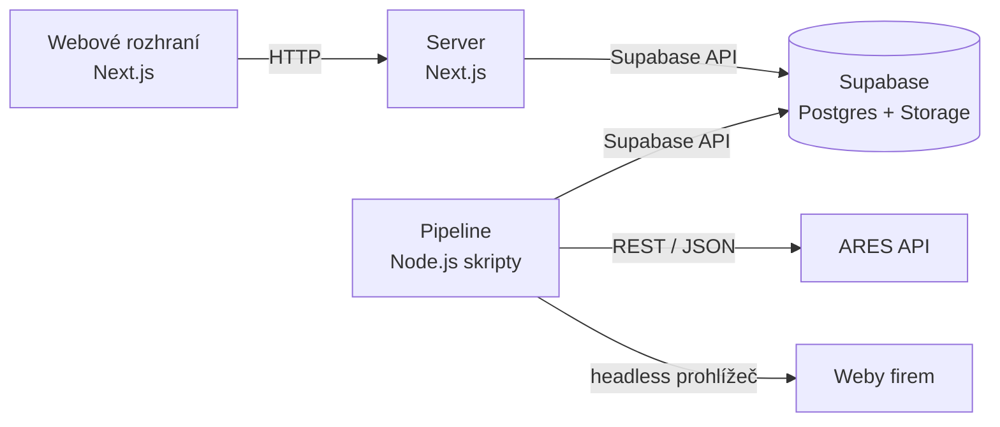

# Wexli Scout

Interní nástroj, který v registru ARES najde malé firmy podle oboru, ověří, jestli mají funkční web, a výsledek uloží jako podklad pro osobní oslovení.

## Co nástroj dělá
- Načte firmy z ARES podle oboru (CZ-NACE), právní formy a městské části.
- Dohledá web firmy a ověří, že patří právě jí (IČO, název a adresa na stránce).
- Zkontroluje dostupnost, HTTPS, zobrazení na mobilu a stáří webu a uloží screenshot.
- Seřadí firmy podle důvodu k oslovení a po ručním ověření připraví report pro firmu.
- Eviduje stav oslovení.

## Pro koho
Primárně pro provozovatele webového studia Wexli (jeden uživatel, interní nástroj). Nepřímo pro malé firmy, které se z reportu dozví konkrétní problém svého webu.

## Stav (listopad 2026)
Hotový je návrh a dokumentace. V repu je kostra aplikace: Next.js, testy a migrace první tabulky. Dalším krokem je import z ARES, harmonogram je v [project charteru](docs/01-project-charter.md#milníky).

## Stack
Next.js (React, TypeScript) · Supabase (PostgreSQL, Storage) · Playwright (headless Chromium) · Vitest. Zdůvodnění je v [architektuře](docs/02-architektura.md).



## Struktura repa
```
src/        aplikace (Next.js)
supabase/   migrace databáze
tests/      unit testy (Vitest) a testy v prohlížeči (Playwright)
docs/       dokumentace projektu
```

## Spuštění
Kostra jde spustit lokálně (Node.js 20.9 nebo novější):

```bash
npm install
npm run dev
```

Na http://localhost:3000 je zatím jen prázdná stránka „Firmy“. Napojení na Supabase a import z ARES zatím hotové nejsou. Testy se spouští přes `npm test` a `npm run test:e2e`.

## Ochrana dat
Do gitu nepatří tajné klíče (`.env.local`) ani data o firmách. Odpovědi z ARES, ručně ověřený vzorek, screenshoty a reporty skutečných firem jsou v `.gitignore`. Podrobnosti jsou v [architektuře](docs/02-architektura.md#bezpečnost-a-soukromí).

## Dokumentace
- [Rozcestník a otevřená rozhodnutí](docs/README.md)
- [Project charter](docs/01-project-charter.md): rozsah MVP, milníky, rizika
- [Architektura](docs/02-architektura.md): stack, schéma, import z ARES
- [User flow a use cases](docs/03-user-flow-a-use-cases.md)
- [Business a PR](docs/04-business-a-pr.md)

Autor: Matěj Kostka
