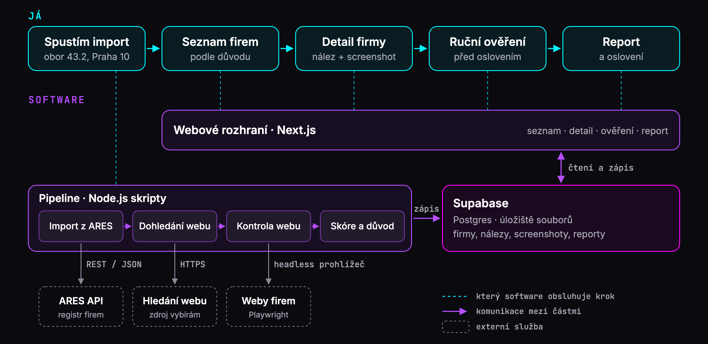
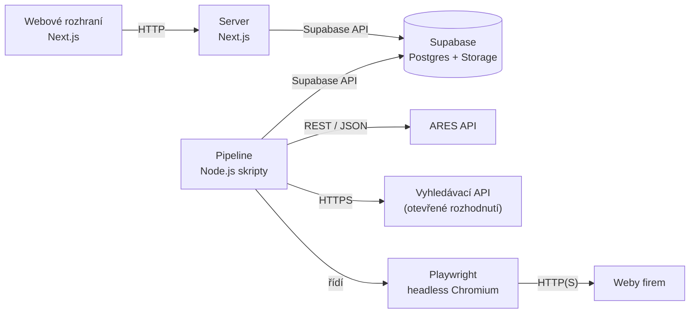
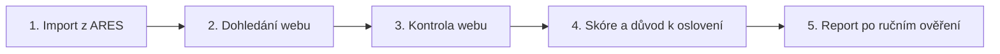
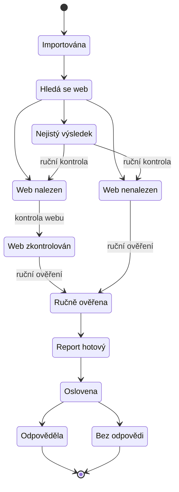
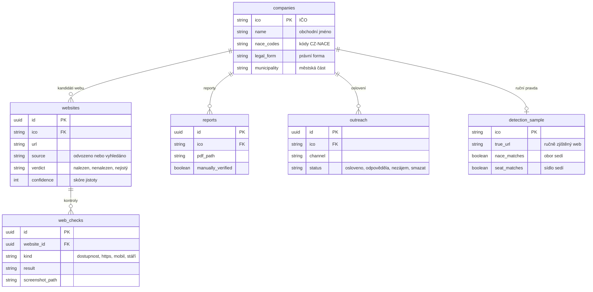

# Architektura

## Stack a zdůvodnění

| Část | Volba | Proč | Stav |
|---|---|---|---|
| Aplikace (UI + server) | Next.js 16 (React, TypeScript) | webový vývoj umím, jedna aplikace pokryje rozhraní i server | kostra hotová |
| Databáze | Supabase (PostgreSQL) | hostovaná databáze v tarifu Free, migrace v gitu, řízení přístupu (RLS) | projekt založený, první migrace napsaná |
| Úložiště souborů | Supabase Storage | screenshoty a PDF reporty v soukromém úložišti | plánováno |
| Zpracování (pipeline) | Node.js skripty v TypeScriptu | dlouhé úlohy (import, kontroly webů) běží lokálně, mimo webový server | plánováno |
| Headless prohlížeč | Playwright (Chromium) | screenshoty, zobrazení na mobilu, převod reportu do PDF | v projektu (testy) |
| Validace dat | zod | kontrola tvaru odpovědí z ARES | plánováno |
| Testy | Vitest, Playwright Test | ke každé kontrole test, který umí selhat | hotové pro kontrolu IČO |

Kritéria výběru: co umím (webový vývoj), práce s headless prohlížečem, jednoduchost (jeden uživatel, interní nástroj), nulové náklady v MVP a čas do dubna. Nástroj v MVP běží lokálně, nasazení na internet je mimo rozsah.

## Schéma komponent

Nahoře kroky uživatele, dole části softwaru, které je obsluhují (stejný diagram je na slidu 3):



Stejné vazby jako text pro GitHub:



Rozhraní, server i pipeline běží lokálně. Supabase je hostovaná služba: v Postgresu jsou firmy a výsledky, ve Storage screenshoty a reporty, ke kterým rozhraní přistupuje přes podepsané odkazy.

Pipeline zpracuje každou firmu v pěti krocích:



## Životní cyklus firmy



Z kteréhokoli stavu jde firma smazat na vlastní žádost. Smažou se i její screenshoty a reporty.

## Datový model



Zatím je napsaná jen migrace tabulky `companies`, ostatní tabulky jsou plánované.

## Import z ARES

### Co z ARES jde a nejde získat
- **Jde:** IČO, obchodní jméno, sídlo jako strukturovaná adresa včetně městské části, právní forma, kódy CZ-NACE, datum vzniku a zániku a stav registrací.
- **Nejde:** web, e-mail ani telefon. V prvních 100 záznamech Prahy 10 nebyl odkaz na web ani jednou. Dohledání webu je proto samostatný krok s vlastním zdrojem.
- Údaje z ARES mají podle Ministerstva financí jen informativní charakter.

### Jak import funguje
1. **Endpoint:** `POST https://ares.gov.cz/ekonomicke-subjekty-v-be/rest/ekonomicke-subjekty/vyhledat` (REST API verze 1.4, zdarma, bez klíče).
2. **Kódy oboru** se načtou z číselníku ARES (`/ciselniky-nazevniky/vyhledat`, číselník `CzNace`). Skupina 43.2 v něm má 10 kódů a dotaz použije všechny.
3. **Filtr:**
   ```json
   {
     "start": 0,
     "pocet": 100,
     "pravniForma": ["112"],
     "czNace": ["432", "4321", "43210", "4322", "43221", "43222", "4323", "43230", "4324", "43240"],
     "sidlo": { "kodObce": 554782, "kodMestskeCastiObvodu": 500224 }
   }
   ```
   `112` je s.r.o., `554782` Praha, `500224` Praha 10.
4. **Stránkování** přes `start` a `pocet`. Dotaz, který by vrátil víc než 1 000 výsledků, ARES celý odmítne s chybou `CHYBA_VSTUPU`. Větší region se proto dělí na menší dotazy, třeba po městských částech.
5. **Tempo:** dotazy postupně, ne paralelně, s prodlevou (návrh 1 s). To je hluboko pod hranicí 500 dotazů za minutu, nad kterou může MF omezit přístup. Limity se neobcházejí, třeba přes víc IP adres.
6. **Cache:** odpovědi se ukládají lokálně mimo git (`/data/`). Opakovaný běh se ARES znovu neptá, což zároveň brání opakování stejných dotazů, které MF také uvádí jako důvod k omezení.
7. **Validace:** tvar odpovědi (zod) a IČO kontrolní číslicí.
8. **Jen aktivní subjekty:** firma s datem zániku nebo neaktivní registrací se přeskočí.
9. **Uložení:** upsert podle IČO (primární klíč `companies`), takže druhý import nevytvoří duplicity.

### Slabá místa dat
Zjištěno 8. 11. 2026 dotazy na ARES. Zaznamenané jsou jen počty, žádné údaje o firmách.

| Zjištění | Data | Co s tím |
|---|---|---|
| Strop výsledků | s.r.o. v celé Praze se skupinou `43` = 1 738 výsledků, ARES dotaz odmítne („Povoleno je maximálně 1 000 výsledků“) | dělit dotazy |
| Kódy na různých úrovních, filtr hledá přesnou shodu | z 10 kódů skupiny 43.2 se u s.r.o. v Praze 10 vyskytuje jen 5: `432` (9 firem), `4322` (203), `43210` (268), `43230` (1), `43240` (66). Kódy `4321`, `43221`, `43222`, `4323`, `4324` mají 0. | dotaz se všemi kódy z číselníku, ne odhad |
| Víc kódů na firmu | v prvních 100 záznamech má firma 2 až 23 kódů CZ-NACE, medián 8 | skutečný obor ověřit na vzorku |
| Dva číselníky | filtr `czNace` hledá v CZ-NACE 2025: shoda u 100 ze 100 záznamů, ve starém `czNace2008` jen u 54 | pracovat s CZ-NACE 2025 |
| Sídlo není místo působení | sídlo v ARES nemusí být tam, kde firma působí (např. virtuální sídla) | MVP volí obytnou Prahu 10, sídlo ověřit na vzorku |
| Aktivní subjekty | v prvních 100 záznamech žádný zánik, registrace aktivní | kontrolu ponechat, levná pojistka |
| Velikost MVP | Praha 10, s.r.o., skupina 43.2 = **469 firem** | pod stropem, stačí jeden filtr se stránkováním |

### Jak změřím kvalitu importu

| Metrika | Jak | Cíl |
|---|---|---|
| Úplnost | počet uložených firem proti `pocetCelkem` z ARES | 100 % |
| Duplicity | druhý import stejného filtru | 0 nových řádků |
| Platnost IČO | kontrolní číslice | 100 % |
| Aktivní subjekty | datum zániku a stav registrace | 0 zaniklých v databázi |
| Obor sedí | ruční kontrola na vzorku 100 firem (tentýž vzorek jako u detekce) | změřit a uvést |
| Sídlo sedí | ručně na stejném vzorku | změřit a uvést |

## Dohledání a ověření webu

**Kandidáti (návrh):**
1. **Odvození domény z obchodního jména:** bez právní formy a diakritiky, s pomlčkou i bez, koncovka `.cz`. Například „Elektro Novák s.r.o.“ dá `elektronovak.cz` a `elektro-novak.cz`. Zdarma a bez externí služby.
2. **Vyhledávací API** (dotaz „obchodní jméno + Praha“). Kandidátem je Brave Search API: 5 USD za 1 000 dotazů, měsíční kredit 5 USD. Ukládat výsledky dovoluje jen plán, který k tomu má výslovné právo, a to musím ověřit. Na 469 firem by v MVP stačilo zhruba 469 dotazů (odhad).
   - Google Custom Search JSON API je pro nové zákazníky uzavřené a končí 1. 1. 2027.
   - Automatické stahování výsledků z Googlu jeho podmínky nepovolují.

Výběr zdroje je otevřené rozhodnutí do konce listopadu 2026.

**Ověření shody:** pipeline stáhne úvodní stránku a stránku s kontakty a hledá:
- **IČO firmy** jako silný signál. Podnikatel musí na svých internetových stránkách uvádět jméno, sídlo a IČO (§ 435 odst. 1 občanského zákoníku). Ne každý web tuhle povinnost plní, proto se IČO kombinuje s dalšími signály.
- **Obchodní jméno a adresu sídla** jako slabší signál.
- **Znaky, že web nepatří firmě:** parkovaná doména, „doména je na prodej“, přesměrování na profil na sociální síti. Takový web se nepočítá.

**Skóre jistoty (návrh):** IČO na stránce = nalezen. Jméno a adresa = nalezen s nižší jistotou. Jen podobné jméno = nejistý (jde do ruční kontroly). Nic = nenalezen.

**Ruční kontrola:** každý nejistý výsledek a každá firma před oslovením.

## Hodnocení webu

| Kontrola | Jak | Výsledek |
|---|---|---|
| Dostupnost | stavový kód HTTP, timeout (návrh 15 s), přesměrování | dostupný, nebo chyba |
| HTTPS | platný certifikát, přesměrování z HTTP na HTTPS | v pořádku, chybí, nebo neplatný |
| Mobil | šířka okna 390 px (návrh), meta viewport, vodorovné přetékání, screenshot | použitelný, nebo nepoužitelný na mobilu |
| Stáří (návrh) | rok v patičce, verze CMS (meta `generator`), zastaralé knihovny | odhad stáří |

**Důvod k oslovení** je nejzávažnější nález. Pořadí (návrh): bez webu > nedostupný > bez HTTPS > nepoužitelný na mobilu > zastaralý.

Každá kontrola má lokální testovací stránku s chybou a bez chyby. Kontrola musí chybu chytit a na stránce v pořádku mlčet.

## Bezpečnost a soukromí
- **Tajné klíče** jsou jen v `.env.local` (mimo git), v `.env.example` jsou názvy proměnných bez hodnot.
- **Data o firmách** (odpovědi z ARES, cache, vzorek, screenshoty, reporty) do gitu nepatří, mají vlastní adresáře v `.gitignore`.
- **Databáze:** zapnuté RLS, tabulky se automaticky nezpřístupňují, přístup má jen serverová role.
- **Šetrné stahování:** rozumné tempo, identifikovatelný user-agent (název nástroje a kontaktní stránka, návrh) a respekt k `robots.txt`.
- **Úložiště:** screenshoty a reporty v soukromém úložišti, smazání na žádost firmy.

## Zdroje (ověřeno 8. 11. 2026)
- [ARES REST API, OpenAPI specifikace](https://ares.gov.cz/ekonomicke-subjekty-v-be/rest/v3/api-docs)
- [Ministerstvo financí: ARES, podmínky provozu a technická dokumentace](https://mf.gov.cz/cs/ministerstvo/informacni-systemy/ares--administrativni-registr-ekonomicky)
- [Google: Custom Search JSON API, přehled](https://developers.google.com/custom-search/v1/overview)
- [Brave Search API: ceník](https://brave.com/search/api/)
